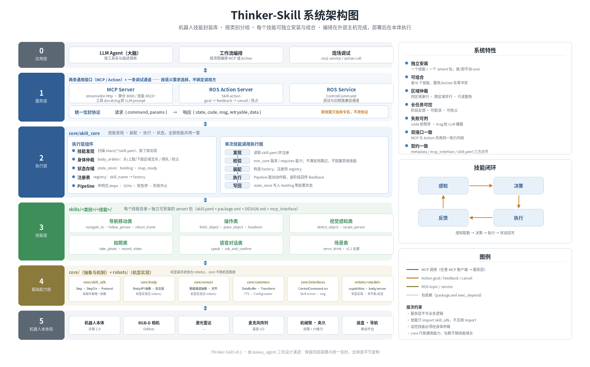

# Thinker-Skill 概要设计文档

| 项       | 内容                                                                                                                                                             |
| -------- | ---------------------------------------------------------------------------------------------------------------------------------------------------------------- |
| 版本     | v1.0                                                                                                                                                             |
| 状态     | 已评审                                                                                                                                                       |
| 日期     | 2026-11-11                                                                                                                                                       |
| 本文定位 | 概要设计：产品定义、系统架构、模块划分                                                                                                                           |
| 配套文档 | [`Thinker-Skill 详细设计文档.md`](<Thinker-Skill 详细设计文档.md>) 实现方法 · [`接口文档.md`](接口文档.md) 接口定义 · [`决策记录.md`](决策记录.md) 决策推演 |
| 参考实现 | `kaiwu_agent/{detect_object, fetch_object, place_object}` 三包                                                                                                 |

> 三份文档的边界：**本文讲"是什么、为什么这样切"**；详细设计文档讲"怎么做"；接口文档讲"怎么调"。冲突时以决策记录为准。

---

## 1. 产品概述

Thinker-Skill 是部署在机器人本体上的**技能库**：把"感知 + 运控 + 状态机"闭环封装成可独立安装的技能单元，通过 **MCP Server** 与 **ROS Action Server** 两条通用接口对外提供服务，两者不绑定调用方。

- **痛点**：参考实现三包平台代码重复、同机互斥、仅同步 Service 无进度/取消。
- **价值**：可安装（一个技能一个包）、可组合（命名空间隔离 + 区域仲裁）、双接口（共用执行内核）。
- **调用方**：LLM Agent、工作流编排。
- **边界**：编排在外部主机；应用层与算法实现不属本库（算法随技能走）。

---

## 2. 总体架构

### 2.1 系统架构图



Thinker-Skill 采用六层架构：**应用层 → 服务层 → 执行层 → 技能层 → 基础能力层 → 机器人本体层**。调用自上而下穿透，结果原路回传。

架构围绕三个目标组织：

- **可安装**：一个技能 = 一个 ament 包，装/卸不影响基础能力层与其他技能。
- **可组合**：技能命名空间隔离；运控技能按身体区域仲裁（同区域串行、跨区域并行），只读技能可并行。
- **双接口**：MCP 面向 LLM Agent，ROS Action 面向工作流编排，两者共用同一信封与同一个执行内核。

> 该图由 `tools/render_architecture.py` 生成，改图请改脚本后重新渲染，避免图片与文档脱节。

### 2.2 架构要点

| 层             | 职责                                                           |
| -------------- | -------------------------------------------------------------- |
| 0 应用层       | LLM Agent、工作流编排、现场调试（不属于本库）                  |
| 1 服务层       | 协议翻译：MCP Tool / Skill.action / ControlCommand             |
| 2 执行层       | 装配已安装技能，执行期统一治理：排队、身体仲裁、取消、状态回写 |
| 3 技能层       | 业务动作链与参数，只依赖 `skill_sdk`                         |
| 4 基础能力层   | 能力契约、控制器、感知数据通道、基础设施、接口定义；全库只写一份 |
| 5 机器人本体层 | 机器人本体与传感器，由基础能力层适配                           |

跨层约束：技能只经服务层互相调用、不 `import` 彼此源码（保证可独立卸载）；服务层只做参数翻译与错误归一化；运控技能必须经 `body_arbiter` 按身体区域（头部 / 上肢 / 下肢）仲裁并取得租约后才能驱动身体（保证组合部署时不抢硬件）。

对外接口：MCP 与 ROS Action 两条**通用接口**，不绑定调用方 —— 要进度/取消/抢占选 Action，要自描述与跨语言选 MCP。两者共用同一信封 `{state, code, msg, retryable, data}`，新增技能只加命令名、不改协议。对外只暴露一个 MCP 聚合端口（默认 8000），每技能独立端口（8022+）仅用于平台注册。通道对比与字段定义见《接口文档》第 1、2 章。

---

## 3. 模块划分

系统由三类模块构成：**Skill 模块**（`skills/`，业务实现）、**Core 模块**（`core/`，共享能力与执行机制）、**协议适配模块**（`python/`，MCP 桥与技能聚合器）。

顶层目录：

```
Thinker-Skill/
├── skills/<类别>/<技能>/   技能包，每个 = 一个独立可安装的 ament 包
├── core/                   平台核心，六个 ament 包（见 3.2）
├── robots/                 机型适配，一机型一包（见 3.4）
├── python/                 协议适配：MCP 桥、技能聚合器、客户端 SDK
├── configs/                跨技能共享配置（机型 / 相机 / 场地 / 错误码文案）
├── weights/                模型权重（不入库）
├── .colcon/                colcon 产物 build/install/log（gitignore）
└── docs/ tools/ tests/    文档、脚本、测试
```

### 3.1 Skill 模块

**定位** —— 业务实现的唯一载体：机器人在具体场景下「做什么、怎么判断成败」的全部语义都在这里，`core` 不含任何业务。

**结构** —— 一个技能 = 一个目录，固定在 `skills/<类别>/<技能>/`，内含 ROS 包与平台注册壳两棵子树：

```
skills/manipulation/fetch_object/
├── skill/                            # ament 包（包名 fetch_object）
│   ├── package.xml / setup.py        # exec_depend thinker_skill_sdk + thinker_interfaces
│   ├── skill.yaml                    # 安装契约：命令、依赖能力、超时、错误码
│   ├── src/fetch_object/             # 业务源码
│   │   ├── plugin.py                 #   入口：build_steps()
│   │   ├── targets.py                #   目标选择策略
│   │   ├── vision.py                 #   检测/位姿算法（本技能自带）
│   │   └── geometry.py               #   本技能特有几何
│   ├── configs/skills/fetch_object.yaml   # 私有参数：偏置、阈值、重试次数
│   ├── launch/skill.launch.py
│   └── start.sh                      # 独立启动（standalone 形态）
├── mcp_interface/                    # 平台注册壳（非 colcon 包）
│   ├── mcp_interface.py              #   工具函数 + docstring
│   ├── metadata.json                 #   平台注册清单
│   └── requirements.txt              #   fastmcp / rclpy 客户端代理依赖
└── DESIGN.md                         # 技能级设计说明
```

两棵子树分开的原因：`skill/` 走 colcon 构建、参与 Cython 编译；`mcp_interface/` 被平台按 `modulePath` 直接导入，**必须保持明文**，且改动不需要重新构建。

**功能** —— 技能承担且只承担四件事：

| 职责 | 内容                                                                       |
| ---- | -------------------------------------------------------------------------- |
| 声明 | `skill.yaml` 说明自己叫什么、需要哪些能力、跑多久、可能返回哪些错误码    |
| 编排 | `build_steps()` 返回 `Step` 列表，描述动作链与失败策略；不写循环与调度 |
| 计算 | 目标选择、位姿计算、检测/估计等业务算法，参数全部来自私有配置 |
| 暴露 | `mcp_interface/` 只放工具函数与 docstring，供平台注册                    |

**边界**：

- 只依赖 `skill_sdk` 与消息包，不 `import` `core` 实现包，也不 `import` 其他技能；
- 不含节点装配、tick 循环、控制器封装、力订阅 —— 这些由 host 与 `core` 提供；
- 可自带专用算法（检测、估计、识别），但必须是**纯函数库**：不装配节点、不订阅话题，由 `Step.run` 在 tick 内调用，模型延迟加载；
- 目录名 = 技能名 = 平台 `metadata.json` 的 `name`；判断一个目录是不是技能，看是否同时具备 `skill/skill.yaml` + `skill/package.xml` + `DESIGN.md`。

### 3.2 Core 模块

**定位** —— 本库的平台侧：把硬件、感知数据与执行机制抽象成稳定接口，向上支撑技能、向下驱动本体。它不含业务逻辑，技能数量增长不会让它变大。

**结构** —— `core/` 由六个 ament 包组成，依赖方向单一：

```
技能包 ──▶ skill_sdk ◀── skill_core ──▶ body / sensor / common
                 ▲
        body / sensor（实现 BodyAPI / SensorAPI Protocol）
```

| 包             | 职责                                                                                               | 谁依赖                                   |
| -------------- | -------------------------------------------------------------------------------------------------- | ---------------------------------------- |
| `interfaces` | 协议定义：`ControlCommand.srv`、`Skill.action`、检测/抓取消息                                  | 全部                                     |
| `skill_sdk`  | 技能作者唯一依赖：`Step`、`StepResult`、`StepCtx`、`BodyAPI`/`SensorAPI`、错误码常量 | 技能包、`skill_core`、`body`、`sensor` |
| `common`     | DataBuffer、TransformUtil、ConfigLoader、logger、TTS                                               | `skill_core`、`body`、`sensor` |
| `sensor` | 感知数据通道抽象：时间戳缓冲、RGB-D 对齐、坐标变换框架；**不含检测算法，不含机型实现** | `skill_core` |
| `body`       | `BodyAPI` 抽象与通用安全层（限幅、急停钩子）；**不含机型实现**                               | `skill_core`                           |
| `skill_core` | 发现、装配、身体仲裁、状态存储、Pipeline、三个服务入口                                             | 部署单元（技能**不**依赖）         |

**功能** —— 六包按角色分三类：**契约**（`interfaces`、`skill_sdk`）、**能力**（`body`、`sensor`、`common`）、**机制**（`skill_core`）。其中两个关键包的分工正好相反：

| | `skill_sdk` | `skill_core` |
|---|---|---|
| 性质 | 契约：类型、Protocol、错误码 | 实现：调度、仲裁、驱动 |
| 依赖 | 无 ROS 运行时依赖 | `rclpy` + `body` + `sensor` + `common` |
| 谁依赖 | 技能包、`skill_core`、`body` | 部署单元，**技能不依赖** |
| 稳定性 | 高，改它等于改所有技能 | 低，内部可自由重构 |

技能单向依赖 `skill_sdk`；`skill_core` 反向依赖它并实现它 —— 两者之间没有依赖边，所以 `core` 内部怎么重构都不影响已安装技能。

`skill_sdk` 的 API 兼容策略（`min_core` 是唯一兼容边界）：

| 级别   | 范围                                                       | 规则                       |
| ------ | ---------------------------------------------------------- | -------------------------- |
| 稳定   | `Step` / `StepResult` / `StepCtx` 字段语义、错误码常量      | 不可改                     |
| 可演进 | `BodyAPI` / `SensorAPI` 方法、`StepCtx` 字段                | 只增不改，新增给默认/可选实现 |
| 破坏性 | 既有方法签名/语义变更                                      | 走 `min_core` 大版本升级   |

技能用 `skill.yaml` 的 `min_core` 声明最低 SDK 版本，装配期校验，不满足则跳过并告警。

**边界**：

- `core` 是**封闭集合**：包数与机器人形态相关，不随技能数量增长；新逻辑只加在既有包内，新增包需架构评审；
- 代码中不出现业务词表（`bottle` / `box` / `drawer`），出现即说明逻辑放错了层；
- 技能永远不依赖 `skill_core`、`body`、`sensor` 的实现包；
- **算法不收进 `core`** —— 检测、估计、识别等实现随技能包走，`core/sensor` 只提供数据与坐标变换。

配置分层、`core` 准入标准与包命名对照见《Thinker-Skill 详细设计文档》第 2 章。

### 3.3 协议适配模块

**定位** —— 非 ROS 侧的协议适配层：把两条通用接口暴露给外部调用方。

| 组件 | 职责 |
| ---- | ---- |
| `thinker_mcp_bridge` | 技能注册壳（`mcp_interface/`）的平台侧桥接 |
| `thinker_mcp_aggregator` | 聚合单端口（8000），技能增删只重启聚合器 |
| 客户端 SDK | 供调用方接入 MCP / Action |

**边界** —— 与 `core/` **不互相 import**，只经 ROS service/action 通信；不含业务逻辑。

### 3.4 机型适配模块

**定位** —— 把不同机型/SDK 的硬件接口适配成统一的 `BodyAPI` / `SensorAPI`，使技能写一次、跨机型跑。一机型一包，随机器人形态增长（不随技能增长）。

**结构** —— `robots/<model>/` 是一个 ament 包，含能力契约、适配实现与机型特有资源：

```
robots/tienkung_dex/          # ament 包 tienkung_dex_robot
├── capabilities.yaml         # 能力契约：能力名 + 参数 + 版本
├── src/                      # body.py / sensor.py / safety.py
└── resources/                # 关节表 / 标定 / URDF
```

**职责**：

| 内容 | 说明 |
| ---- | ---- |
| 能力声明 | `capabilities.yaml` 声明本机型提供的能力、参数与版本，供装配期匹配（D-015） |
| 适配实现 | 实现 `BodyAPI` / `SensorAPI`，封装机型 SDK |
| 机型资源 | 关节表、标定、URDF 等机型独有资源 |

**边界**：

- 机型实现只准放 `robots/`，不进 `core`（保证 `core` 不随机型膨胀）；
- 技能不感知机型，只依赖 `skill_sdk`；
- 新增机型 = 新增 `robots/<model>/` 包，`configs/robot.yaml` 选择加载。

设计模式：适配器（实现接口）、抽象工厂（按机型+后端创建）、策略（real/sim/mock）、注册表（机型发现）。

---

## 4. 技能模型

技能是本库的交付单元。本章定义技能的概念模型（分类、契约、生命周期、状态），具体写法（`Step` 字段、`StepCtx` API、目录模板）见《Thinker-Skill 详细设计文档》第 3 章。

### 4.1 分类

分类口径：**按技能结束后的"世界变化"划分**，不按依赖划分。

| 类别       | 目录              | 判定标准                    | 示例                                                                 |
| ---------- | ----------------- | --------------------------- | -------------------------------------------------------------------- |
| 导航移动类 | `navigation/`   | 改变机器人 base 位姿        | `navigate_to`、`follow_person`、`return_home`                  |
| 操作类     | `manipulation/` | 改变手臂/夹爪状态或物体位置 | `fetch_object`、`place_object`、`handover`                     |
| 拍照类     | `camera/`       | 只产出图像/视频             | `take_photo`、`record_video`                                     |
| 语音对话类 | `speech/`       | 只涉及音频输入输出          | `speak`、`listen`、`ask_and_confirm`                           |
| 视觉感知类 | `perception/`   | 产出结构化世界描述          | `detect_object`、`locate_person`                                 |
| 场景类     | `scene/`        | 编排其他技能完成业务流程    | `serve_drink`、`patrol_inspect`（**v1.1 后置**，见 D-002） |

规则：

- 依赖关系不决定类别（`fetch_object` 依赖感知，但属操作类）
- 类别目录**只是分组**，不建 metapackage；"装一个类别" = `colcon build --base-paths skills/manipulation`
- 场景技能设计期以 `package.xml` 的 `exec_depend` 声明依赖，运行期经 Action 调用其他技能，禁止 import 其他技能源码

### 4.2 安装契约

```yaml
name: fetch_object
version: 1.0.0
category: manipulation
min_core: 0.1.0
entry: fetch_object.plugin:FetchObjectSkill   # 提供 build_steps()，由 host 装配
commands: [fetch_bottle]
requires: [arm, gripper, waist, head, sensor.rgbd]
precondition: []            # 见 4.4
postcondition: {holding: true}
timeout: 120                # 秒；可选。缺省走通道默认（MCP 300s / Action default_timeout）；走 MCP 的取值需小于 sse_read_timeout(300)
interfaces: [mcp, action]   # 对外通道；service 恒可用，仅作调试
errors:                     # 本技能可能产出的 code，供测试与未来编排期校验
  - PERCEPTION_OBJECT_NOT_FOUND
  - PRECOND_BODY_BUSY
  - MOTION_GRASP_FAILED
  - SAFETY_ESTOP_TRIGGERED
config: configs/skills/fetch_object.yaml
mcp: {tools: [fetch_object], port: 8023}
```

该文件随包安装到 `share/<pkg>/skill.yaml`，并在 ament index 打 marker。**装了就发现，卸了就消失**。

### 4.3 生命周期与技能发现

```
安装（colcon / 离线包）
  → 发现（host 扫描 share/*/skill.yaml）
  → 校验（min_core 版本、requires 能力是否齐备；不满足则跳过并告警，不阻塞其他技能）
  → 装配（导入 entry 构造技能实例，注册到 registry，由 host 起服务层）
  → 执行（Pipeline 10Hz 驱动动作链）
  → 状态写回（state_store）
```

前四步属**装配期**（host 启动时一次），后两步属**调用期**（每次调用）。安装、升级与回滚流程见《Thinker-Skill 详细设计文档》5.4。

### 4.4 前置与后置状态

组合技能之间靠 `state_store` 传递语义状态，而不是靠调用顺序的巧合：

| 状态                             | 写入者            | 读取者                         |
| -------------------------------- | ----------------- | ------------------------------ |
| `holding` / `holding_object` | `fetch_object`  | `place_object`、`handover` |
| `map_ready`                    | 建图技能          | `navigate_to`                |
| `last_detection`               | `detect_object` | `fetch_object`（可选加速）   |

前置不满足时返回可读失败（如"我手上没有东西，请先让我抓取"），而不是执行错误动作。

---

## 5. 非功能需求

| 维度     | 要求                                                                                                                        |
| -------- | --------------------------------------------------------------------------------------------------------------------------- |
| 实时性   | 动作循环 10Hz；感知发布 10Hz；感知→运动取数超时 2s                                                                         |
| 并发     | 同一身体区域（头/上肢/下肢）串行，跨区域可并行；只读技能可与运控技能并行                                                              |
| 启动     | 单技能 launch 冷启动 < 10s；host 加载 N 个技能 < 15s                                                                        |
| 资源     | Jetson aarch64，Python 3.10+，ROS2 Humble / Jazzy                                                                                    |
| 接口时限 | `skill.timeout` 可选、无全局上限；缺省走通道默认（MCP 300s / Action `default_timeout`）；持身体的技能由看门狗兜底                            |
| 安全     | MCP `host` 可配置，默认 `localhost`；对外暴露需显式设 `host` 并前置反代 + 白名单，v1 不做协议层鉴权                          |
| 依赖版本 | 服务端 `fastmcp>=2.12.3,<4`（按 Python 版本自适应：3.10 装 2.x、3.12 装 3.x）；与大脑侧 `fastmcp==3.3.1` 仅保协议兼容                            |
| 可观测   | 结构化日志按技能分文件；`trace_id` 贯穿 MCP → Action → Pipeline                                                         |
| 可回放   | 感知数据可录制回放（**后置**，v1 用 `FakeSensor` 兜底）；`core/sensor` 预留录制/回放接口                                                                                          |
| 依赖面   | 技能包只依赖 `skill_sdk` 与消息包；`core` 包数不随技能增长，机型实现随 `robots/` 增长                                                              |
| 代码保护 | Cython 编译 `core/` 与各技能的 `skill/`；保护边界是 `skill_sdk` 公共符号；`mcp_interface/` 保持明文（FastMCP 需反射签名） |
| 可测试性 | 每个技能必须能仅用 `FakeBody` / `FakeSensor` 在开发机跑通全部步骤                                                   |
